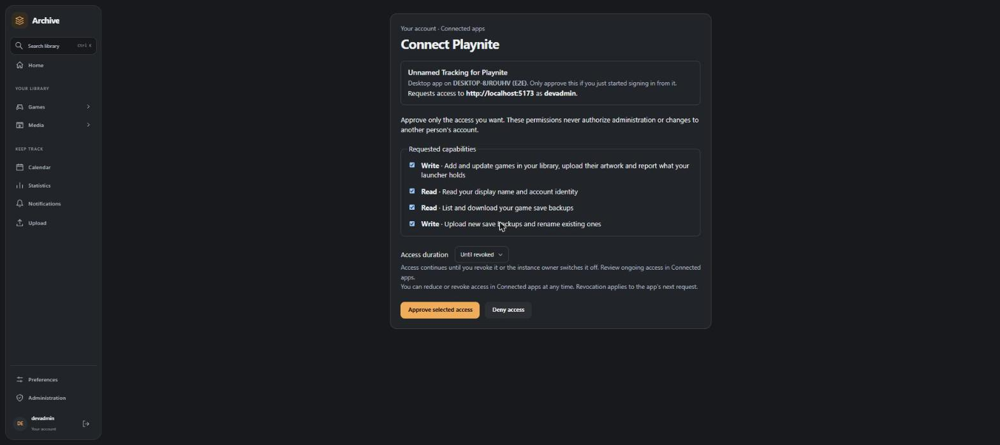
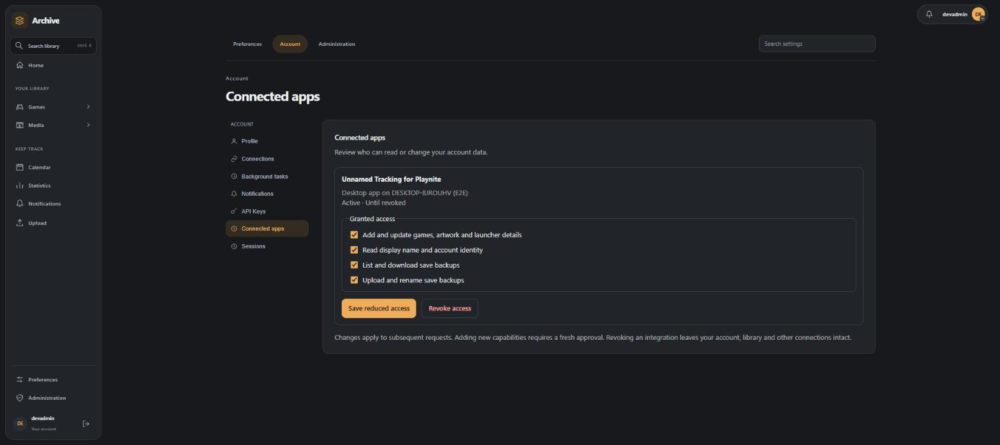

# Installation and configuration

## Requirements

Use Windows and Playnite 10.x and a reachable Unnamed Tracking server. You sign in
with your normal Unnamed Tracking account in your browser; no API key is needed on
servers that offer Playnite sign-in. Older servers still accept a user API key
beginning with `utk_` (see [API key fallback](#api-key-fallback-for-older-servers)).
An application plugin-management token (`utpm_`) cannot access the game APIs used
by this extension. Developing the extension also requires the .NET 8 SDK and .NET
Framework 4.6.2 targeting support; installing a PEXT does not require the developer
tools.

## Install

1. Download a `.pext` from a reviewed [release](https://github.com/obsoletelabs/unnamed_tracking_playnite/releases),
   or obtain a build artifact from the repository's GitHub Actions run. An Actions
   artifact is a ZIP wrapper; extract it to obtain the PEXT.
2. Open the PEXT with Playnite or drag it into Playnite. Accept the installation
   prompt and restart if Playnite requests it.
3. Open **Add-ons → Extension settings → Unnamed Tracking**.

Development builds can instead be loaded from the Release output directory using
Playnite's **Settings → For developers → External extensions**. Keep one installed
copy of the extension to avoid confusing duplicate installations.

## Configure

Enter the server's base URL, for example `https://tracking.example.com`: the address
you open Unnamed Tracking at in your browser. A reverse proxy base path is supported,
such as `https://example.com/tracking`. Use the final URL: API redirects are
rejected. Do not append `/api`, a username and password, a query string, or a
fragment. HTTPS protects your sign-in in transit; HTTP is supported for local
deployments.

### Sign in

Click **Sign in with your browser**. Playnite opens Unnamed Tracking's
**Connect Playnite** page in your normal browser (sign in there first if needed).
It names this computer and lists exactly what the extension asks for:

| Capability | Why the extension needs it |
| --- | --- |
| Read your display name and account identity | Shows *Connected as ...* in these settings |
| Add and update games, artwork and launcher details | Library sync, artwork and Playnite evidence |
| List and download your game save backups | Save download and restore |
| Upload new save backups and rename existing ones | Save upload |

All four start selected and access lasts *Until revoked*, like the API key it
replaces; you can untick any of them or choose a timed grant. Approve, return to
Playnite, and the extension finishes signing in by itself within a few seconds.
If the browser did not open, the settings show the address to visit. **Cancel**
stops waiting; an unanswered request expires after ten minutes.

The extension never sees your password. It receives a revocable credential
(`utd_...`) that only works for the capabilities you approved, and never for
administration, API keys or other accounts. The credential is encrypted with Windows
DPAPI for your Windows account before Playnite stores its settings, and it is only
used for the server it was issued by: changing the server URL needs a new sign-in.

**Sign out** removes the credential from Playnite and revokes it on the server.
You can also review, reduce or revoke access at any time in Unnamed Tracking under
**Account → Connected apps**, where this computer is listed as a desktop app.

Instance owners can turn Playnite sign-in off under **Administration → Integration
access** (*Let people connect desktop apps such as Playnite*). It is on by default
and independent of web integrations such as the Discord Activity.

### API key fallback for older servers

If the server does not offer Playnite sign-in, the settings say so. Expand
**Use an API key instead (older servers)**, create a **user API key** in the
Unnamed Tracking application's account settings and paste it there. A `utk_` key has
full access to your account and is stored unencrypted in Playnite's extension
settings, so treat the Playnite profile and its backups as sensitive. It is sent only
in the HTTP `Authorization: Bearer` header, never in page or download URLs. A
browser sign-in takes precedence over a stored key.

Leave automatic synchronization disabled until the connection and initial preview
look correct. The default ignore tag is `trackingapp_ignore`. See
[ignored games](synchronization.md#ignored-games) before changing it.

## Test the connection

Click **Test connection**. It sends an authenticated read of one game from
`/api/game/list`; an empty account is valid. Success verifies reachability,
authentication (your sign-in or API key), and a readable game-list response. It
does not prove that artwork or save uploads fit the server's size limits.

The test uses the values currently entered in settings, even before saving them.
Save your settings in Playnite to persist changes. See
[troubleshooting](troubleshooting.md) if the test fails.
