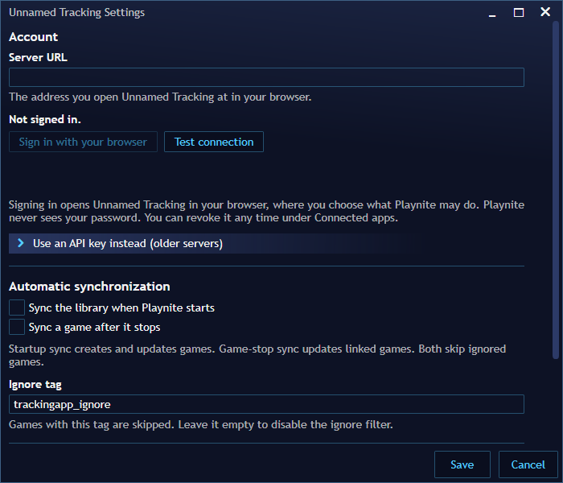

# Screenshots and runtime verification

Captured on 2026-10-18 from a portable **Playnite 10.62** on Windows 11, with the
extension built from this repository and a local Unnamed Tracking server
(host PR obsoletelabs/unnamed_tracking_app_2#276). Only the Playnite window was
captured.

| View | Evidence |
| --- | --- |
| Extension settings, signed out |  |
| Extension settings, signed in |  |
| Consent page opened by the extension |  |
| Connected apps on the server |  |
| Sync preview, progress, context menus, save sync UI, embedded view | Not captured yet: the test install had no game library. Use the procedure below. |

The sign-in run is reproducible without touching the desktop: install the build into
a portable Playnite's `Extensions` folder, set `ApiUrl` in
`ExtensionsData/4a8d9c7b-2e54-4a6b-9c6d-0a2b8f1e7d43/config.json`, start Playnite and
open `playnite://unnamedtracking/sign-in` (`Playnite.DesktopApp.exe --uridata
playnite://unnamedtracking/sign-in`). The consent page address is written to
`extensions.log`; approve it in a browser signed in to the server, and the extension
logs *Connected as ...*. `playnite://unnamedtracking/settings` then opens the settings
dialog for a capture.

To add the missing views, record extension version, Playnite version, Windows
version, capture date and the action shown, save sanitized images under
`wiki/docs/assets/`, and replace the row above.

## Manual runtime acceptance checklist

Use disposable test saves and a test account. Verify settings persistence,
connection errors, full/selected sync, rename without duplication, custom status
normalization, ignore tags, preview with no writes, progress/cancel, artwork
warnings, startup and game-stop events. Test multiple folders and a single file,
automatic upload versioning, launch pause and the second launch, cancel/failure
with original saves intact, shutdown during transfer, and normal browser sign-in
and unavailable-server behavior. Confirm PEXT installation and extension reload.

The 2026-10-18 run covered installation and extension load, settings persistence,
browser sign-in through a `playnite://` link, the signed-in settings view, and an
encrypted stored credential. Library sync, saves and the embedded view were exercised
against the same server through the extension's own code outside Playnite, not yet
inside a Playnite library. The checklist remains an explicit release gate.
